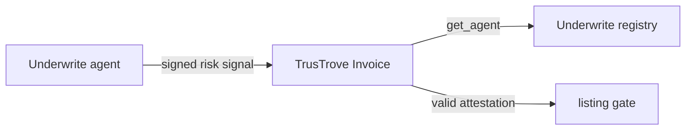

# Underwrite Agent Registry

Underwrite is an invoice verification layer for Stellar. A verification agent checks an invoice, signs a risk signal, and posts it to a Soroban registry. TrusTrove lists an invoice for financing only if a valid attestation exists. This repository contains the agent registry that stores each approved agent's secp256k1 public key and active status.

Testnet only. Unaudited. No mainnet deployment exists. End-to-end flow: in progress.

## How the repositories fit together

| Repository | Role |
| --- | --- |
| [`UnderWrite-contract`](https://github.com/UnderWritex402/UnderWrite-contract) | Soroban agent registry in this repository. |
| [`UnderWrite-app`](https://github.com/UnderWritex402/UnderWrite-app) | Off-chain invoice verification agent and attestation client. |
| [`TrusTrove-contract`](https://github.com/TrusTrove/TrusTrove-contract) | Invoice contract that calls the registry through `submit_attestation`. |

All three repositories are needed for the full flow.

## Testnet deployment

| Component | Network | Contract ID | Status |
| --- | --- | --- | --- |
| Agent registry | Stellar testnet | [`CB22R3OJUCQGHZCXH5WAONTURVMSGDIDGIGXA2XQ6UNXDUKYWZKVTER5`](https://stellar.expert/explorer/testnet/contract/CB22R3OJUCQGHZCXH5WAONTURVMSGDIDGIGXA2XQ6UNXDUKYWZKVTER5) | Contract instance resolved on testnet. |

The registered agent ID `underwrite_v1` was confirmed active with a read-only `get_agent` simulation.

## Maintainers

| Name | Role | GitHub | Telegram |
| --- | --- | --- | --- |
| `{{NAME}}` | Maintainer | `{{GITHUB}}` | `{{TELEGRAM}}` |

Community: `{{COMMUNITY_LINK}}`

Demo video: `{{DEMO_VIDEO_URL}}`
