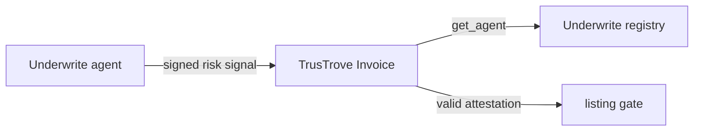

# Underwrite Agent Registry

[](https://github.com/UnderWritex402/UnderWrite-contract/actions/workflows/ci.yml)


Underwrite is an invoice verification layer for Stellar. A verification agent checks an invoice, signs a risk signal, and posts it to a Soroban registry. TrusTrove lists an invoice for financing only if a valid attestation exists. This repository contains the agent registry that stores each approved agent's secp256k1 public key and active status.

Testnet only. Unaudited. No mainnet deployment exists. End-to-end flow: in progress.

## How the repositories fit together

| Repository | Role |
| --- | --- |
| [`UnderWrite-contract`](https://github.com/UnderWritex402/UnderWrite-contract) | Soroban agent registry in this repository. |
| [`UnderWrite-app`](https://github.com/UnderWritex402/UnderWrite-app) | Off-chain invoice verification agent and attestation client. |
| [`TrusTrove-contract`](https://github.com/TrusTrove/TrusTrove-contract) | Invoice contract that calls the registry through `submit_attestation`. |

All three repositories are needed for the full flow.



## Testnet deployment

| Component | Network | Contract ID | Status |
| --- | --- | --- | --- |
| Agent registry | Stellar testnet | [`CB22R3OJUCQGHZCXH5WAONTURVMSGDIDGIGXA2XQ6UNXDUKYWZKVTER5`](https://stellar.expert/explorer/testnet/contract/CB22R3OJUCQGHZCXH5WAONTURVMSGDIDGIGXA2XQ6UNXDUKYWZKVTER5) | Contract instance resolved on testnet. |

The registered agent ID `underwrite_v1` was confirmed active with a read-only `get_agent` simulation.

## Maintainers

| Name | Role | GitHub | Telegram |
| --- | --- | --- | --- |
| Fuhad Adesanya | Maintainer | [@K1NGD4VID](https://github.com/K1NGD4VID), [@fadesany](https://github.com/fadesany) | [@K1NGD4VID](https://t.me/K1NGD4VID) |

## Quick Start

Prerequisite: a stable Rust toolchain.

```bash
git clone https://github.com/UnderWritex402/UnderWrite-contract.git
cd UnderWrite-contract
cargo fmt --all -- --check
cargo clippy --workspace --all-targets
cargo test --workspace
```

The current test suite has 7 tests. The commands above were checked from a fresh clone.

## Contract interface

| Function | Parameters | Return | Authorization and errors |
| --- | --- | --- | --- |
| `initialize` | `admin: Address` | `()` | Callable once. A second call panics with `AlreadyInitialized`. |
| `register_agent` | `admin: Address`, `agent_id: Symbol`, `pubkey: BytesN<65>` | `()` | Requires `admin` authorization and the stored admin address. Panics with `NotInitialized` or `Unauthorized`. |
| `revoke_agent` | `admin: Address`, `agent_id: Symbol` | `()` | Requires `admin` authorization. Panics with `NotInitialized` for a missing agent or admin and `Unauthorized` for the wrong admin. |
| `get_agent` | `agent_id: Symbol` | `Option<AgentInfo>` | Public read. Returns `None` for an unknown agent. |

`AgentInfo` contains `pubkey: BytesN<65>` and `active: bool`. Registration writes an active record. Revocation keeps the record and sets `active` to `false`. Agent records use persistent storage and extend their TTL on registration or revocation.

## Security and license

Read [SECURITY.md](SECURITY.md) before reporting a vulnerability. Audit status: unaudited.

No `LICENSE` file is present. The repository owner must select a license before contributors can rely on reuse terms.

## Contributing

Read [CONTRIBUTING.md](CONTRIBUTING.md), then:

1. Pick an unassigned issue with no unmet dependency.
2. Create a branch such as `feat/123-short-name` from `main`.
3. Use Conventional Commits, for example `test(registry): cover revoked agents`.
4. Open a pull request that links the issue, includes tests, updates docs, and passes CI.

## Contributors

[](https://github.com/UnderWritex402/UnderWrite-contract/graphs/contributors)
